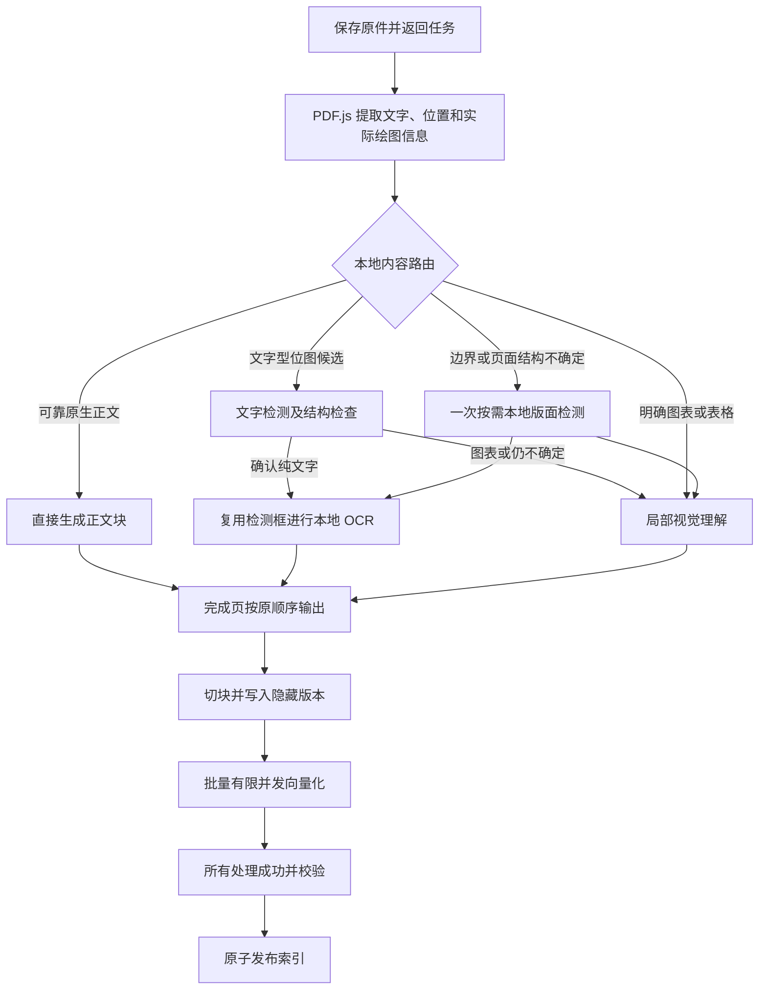

# PDF 唯一自动解析流水线：审计与改造设计

日期：2026-11-06。状态：设计待确认，尚未修改产品逻辑。

## 1. 用户目标与已有约束

正式环境只有一条解析链路，在同一份文档内自动选择原生文本提取、本地 OCR、局部图表理解。文字截图不应因为存在图片就调用视觉大模型，纯文字不应运行 OCR 或视觉模型。减少首次索引就绪时间，同时保留真实图表的重要数字、标签、连线和引用。

沿用已确认的完整发布规则：全部正文、图片识别、切块及向量写入成功后才发布新索引，重建期间继续使用旧索引。普通及流式问答继续只接收文字证据。

本设计提出移除两套运行分支，保留现有 NestJS、PDF.js、Canvas、本地 Python/PaddleOCR、百炼、向量库及引用接口。以下具体调度参数和实现边界属于本次建议，尚未视为用户批准。

## 2. 当前链路审计

目前链路为：接收上传并保存原件 → 返回后台任务 → 完整解析 PDF → 完整切块 → 保存候选版本的块 → 分批串行向量化与写入 → 校验并原子发布。

上传 HTTP 本身已经异步化。界面里长时间等待的主要是首次索引构建，不是文件传输。没有证据支持先重写上传协议或换数据库。

| 发现 | 代码依据 | 处理建议 |
| --- | --- | --- |
| `legacy` 和 `hybrid` 两套执行分支，只有后者接入本地 OCR | `pdf-visual.service.ts` 的 `hybrid`、`page()`、`hybridPage()` | 合并为唯一自动路由；兼容历史数据不要求保留旧执行器 |
| 原生快路径把已有候选统一构造成 `figure`，文字型图片仍可能走视觉模型 | `hybrid-layout.ts` 的 `nativeRegionsReady()` 及后续分支 | 识别图片内容类型；确认纯文字时本地 OCR |
| 几何候选定位、1280 页面渲染、M 检测、2560 页面渲染、plus-L 检测及最终裁剪可能串联 | `hybrid-layout.ts` 的 `layout()` | 几何边界可信时直接用；仅不确定区域运行一次本地版面检测 |
| 为生成布局缓存键，命中缓存前仍需整页渲染，并逐页健康请求 | `hybrid-layout.ts` 的 `layout()` | 不可变文件与页面身份先查缓存；会话复用模型清单，响应校验版本 |
| 多页识别任务持有页面租约，可能互相淘汰唯一页面栅格 | `pdf-render-cache.ts`、`pdf-visual.service.ts` | 页面生产者准备裁剪，识别消费者只持有字节；网络等待不持有 Canvas |
| 两套视觉调用、格式修复、缓存逻辑重复 | `pdf-visual.service.ts` | 提取单一识别执行器，按路由调用 OCR 或视觉模型 |
| 所有识别结束后才开始切块与向量化 | `indexing.service.ts` | 完成页有序输出，私有版本切块与向量化同后续识别重叠 |
| 外层每批 16 条，百炼内部再拆为 10+6，且全部串行 | `indexing.service.ts`、`embeddings.service.ts` | 按提供方能力统一分批；当前百炼上限沿用代码中的 10 条，有限并发 2 |
| 重试无法直接复用已经成功获得的远程向量 | `embeddings.service.ts`、索引任务流程 | 缓存成功向量并校验模型、输入、维度；隐藏版本仍完整校验 |

需要保留的设计：租户隔离、缓存校验、超时、取消与执行权检查、429 冷却、有限并发、来源定位、隐藏索引版本及原子发布。它们是正确性保障，不能用删除这些检查来换取看似更快。

### 已有基准证据及限制

以下均为 CH3 数据链路层 176 页的历史记录，视觉调用使用固定 500ms 的模拟响应，本地模型真实运行；不包含切块、向量化及完整上传就绪过程。本轮未新增真实模型调用。

| 记录目录（`nestjs/.data/` 下） | 解析墙钟秒 | 区域数 | 模拟视觉请求 | 布局请求 / HTTP 累计秒 | OCR 请求 / HTTP 累计秒 |
| --- | ---: | ---: | ---: | ---: | ---: |
| `ch3-original-delay500` | 91.237 | 490 | 490 | 0 / 0 | 0 / 0 |
| `ch3-fixed-delay500` | 22.142 | 86 | 86 | 0 / 0 | 0 / 0 |
| `ch3-final-hybrid-all` | 274.044 | 93 | 85 | 139 / 269.198 | 9 / 3.853 |
| `ch3-final-hybrid-native-regions` | 149.581 | 82 | 79 | 74 / 147.469 | 3 / 0.570 |

HTTP 累计时间包含服务排队和通信，并非纯模型 CPU 时间，也不能直接与墙钟相加。数据足以说明增加版面模型不是免费优化；减少重复版面推理比立刻更换 OCR 框架更值得优先验证。不能把 22 秒宣传为真实文件上传后可对话的速度，也不能只按请求减少判断内容覆盖。

## 3. 成熟方案对照与选型

- [Docling enrichments](https://docling-project.github.io/docling/usage/enrichments/) 将图片分类、图片描述等增强能力分开，明确额外模型会增加耗时。借鉴按需增强，不把所有内容统一发给大模型。
- [Unstructured partition](https://docs.unstructured.io/open-source/core-functionality/partitioning) 提供 `auto`、`fast`、`hi_res`、`ocr_only` 等策略。它的多种策略不是本项目必须向生产用户暴露两个互斥模式的理由；单纯使用最快文字策略也不能保证覆盖图表。
- [RAGFlow DeepDoc 布局源码](https://github.com/infiniflow/ragflow/blob/main/internal/deepdoc/native/dla.go) 使用专门布局检测模型区分文本、图片、表格等。借鉴小模型分工，不推断它能证明当前 CPU 上叠加两次布局检测会更快。

考虑过的路线：

1. **仅把默认配置改成 hybrid。** 修改少，但文字截图可能仍被归为图解，保留重复检测及阶段串行等待，不能解决本次问题。
2. **保留组件，重写自动路由及流水线。推荐。** 对已发现瓶颈有直接证据，能复用原生提取、OCR、图表理解及历史引用，并逐项验证收益。
3. **整体替换为 Docling/MinerU 或改用整份文档 VLM。** 需要重新验证 CPU 内存、部署、引用偏移和文档质量；现有测量没有证明替换整套解析器比消除重复工作更划算。作为后续对照实验，不加入本次生产依赖。

先使用已安装的 PP-OCRv6_small 检测和识别组件；不因 JS SDK 或 ONNX 的存在就引入另一套 OCR。当前 PaddleOCR.js 官方包面向浏览器，不能直接等同于服务端 Node 推理替代方案。只有去掉重复工作后本地推理仍占主要耗时，才做 Paddle CPU 与其他运行时的同质量对比。

## 4. 唯一自动分流

### 4.1 原生层及几何分析

- 原生文字可用、无内容图形及表格疑点：直接保留正文，零 OCR、零视觉调用，不渲染页面。
- 使用文字位置、PDF 实际绘制操作、图注和列结构定位候选；沿用 `endPath` 不视作实际绘图的修正。水印、边框、装饰不能仅按元素数量生成识别任务。
- 无框线表格、多列行对齐仍检查。图内已有原生文字不等于图已理解，不能因此省掉连线或坐标关系识别。
- 明确矢量图、表格、流程图、统计图和需要描述的照片直接走局部视觉理解，不先完整 OCR 再调用视觉模型。

### 4.2 文字型图片

- 位图是否纯文字由文字检测框、行列分布、非文字前景、线框/箭头/网格及上下文共同判断。检测在本地执行，不能调用大模型来决定是否调用大模型。
- 只有明确的纯文字截图或扫描正文运行本地文字识别；检测框直接传给识别器，避免再次执行完整 `PaddleOCR.predict()` 重做检测。已安装 PaddleOCR 暴露独立 `TextDetection` 与 `TextRecognition` 组件。
- 文字多、置信度高不是纯文字充分条件。文本密集的流程图、公式、无框表格、带箭头的关系图不能被 OCR 文本替代。
- 纯文字判断不可靠时保守进入局部视觉模型，记录判定理由。对于难以区分的内容，允许多做检测来保护质量，但不能默认为所有区域都做 OCR 后再做视觉。
- OCR 检查置信度和覆盖/缺失；识别成功且覆盖可靠的纯文字图片到此结束，不调用视觉。若 OCR 正常返回但低置信或漏字，允许对具体缺失区域进行一次局部视觉质量兜底；无法定位缺失时最多处理当前图片区域，不扩展为整页。明确记录 `ocr-quality-fallback`，正常 OCR 的零视觉验收不包含此类质量失败。OCR 接口超时或故障不得触发这种兜底。保留原生 OCR 层并去重，图内原文、模型图解继续标记区分。

### 4.3 按需布局及兜底

- PDF 对象已给出完整可靠边界时跳过布局模型；不确定区域优先裁剪后检测，扫描整页或整体结构不明时才整页本地检测。
- 移除 M→plus-L 自动双重检测。首版沿用现有 M 做一次按需检测，先不新增权重；若后续小模型实测通过质量集，可以更换这个单一实现。
- 扫描页面中的文字与图表分别分流。纯扫描正文允许整页本地 OCR，不需要整页视觉模型。
- 边界仍不可靠、局部裁剪截断关键关系时才整页视觉兜底，记录原因。服务超时、429、响应格式错误不能以整页重试掩盖。
- 服务预热 OCR 与实际使用的单个布局模型，不再加载另一套精度模型。预热完成才就绪；生产用户不选择布局精度或解析模式。

## 5. 有界生产和阶段重叠

### 5.1 解析内部

唯一的页面准备生产者串行使用 PDF.js/Canvas；已知边界的同页区域共享一次足够清晰的栅格，确实不足时才按区域重渲染。识别任务只持有裁剪字节、来源、上下文，不持有 PDF.js 页面或 Canvas 租约。

准备、OCR、视觉识别、向量化使用独立资源队列：渲染 1、本地模型推理 1、视觉默认 3、远程向量批请求默认 2。并发限制按进程共享；保留现有视觉冷却与失败收敛语义。限制是部署参数，不是两套解析模式。

裁剪图仍限制为最多配置数量的在途任务加一个待提交输入；不预生成整份 PDF 图片。页面结果有界前瞻，默认最多领先当前待输出页 2 页；消费者变慢时暂停页面准备，防止等待早期页面时囤积后面整份文档。具体队列封装由实施者决定，但内存和并发上界必须测试。

### 5.2 页面输出、切块与向量化

增加内部有序页面结果流；识别结束顺序可以不同，输出及偏移必须按页面和区域阅读顺序。现有 `parseStructured()` 可收集该流提供兼容接口，不能保留另一套解析策略。

现有结构切块本就按页面分组，因此完成页可以立即进入切块；新增内部页面切块入口或 `textOffset`，把页面局部字符串切片与全局引用偏移分开。不得为流水线修改块大小、重叠规则、父子关联或检索上下文。

页面切块结果写入同一个隐藏索引版本，向量批次可跨已完成页面填满。按提供方能力形成批次：当前远程百炼路径沿用每批 10，本地模型保留适合自己的批量/串行限制。远程最多 2 批同时进行并按输入下标恢复，等待上游时避免每页末尾立即发小批次；上游结束后刷出尾批。

向量化与后续页面识别重叠，不代表提前发布部分文档。全部解析、块持久化、向量写入和现有检索校验通过后才切换 `activeIndexRevisionId`。失败、取消、任务取代均禁止发布。

## 6. 缓存、失败及兼容

- 先按用户/文档版本、原件 SHA、页面、解析算法、模型清单及配置定位缓存；不可变源和确定渲染配置可避免为了查缓存重新整页渲染。缓存仍校验元数据和资源 SHA，缺失或损坏时重新生成对应资源。
- 模型清单在会话首次需要本地推理或读取其缓存时获取一次，每次实际推理响应必须匹配；原生纯文字路径不因健康检查增加本地服务依赖。中途模型变化则停止并重试，不能把不同模型结果混进一个配置指纹。
- 布局、检测/OCR、视觉结果分层缓存；视觉缓存仍含图像和上下文校验值。并发不进指纹，成功区域独立复用，会话内相同在途请求合并。
- 成功向量缓存按租户/文档版本、完整 embedding 模型与 tokenizer profile、输入哈希隔离。复用前校验数量、有限非零数值、维度及配置；不得仅凭块编号跳过写入当前隐藏版本。
- 首次普通处理错误停止新增任务，等待已发请求结束并保存成功缓存，再报告原始错误；不允许本轮未收敛就开始任务重试。用户取消或任务取代则立即终止在途请求并等待资源释放，保留原取消/取代错误类型。统一取消信号贯穿远程向量请求，避免任务结束后后台请求继续计费。
- 保留旧 `pageImage`、区域引用及历史索引读取；移除旧解析执行分支，不迁移或破坏现有可用索引。重建才使用新路由；缺原件仍提示重新上传。
- 删除 `PDF_ANALYSIS_MODE` 与原生快路径开关作为行为选择；如果旧环境显式设置，启动时给一次迁移提示并统一使用自动路由，不静默继续走旧分支。
- `VISION_ENABLED=false` 沿用显式禁用增强的既有含义，只提取原生文字，不能再被文档描述为完整识别模式。正常生产完整识别需要本地服务及视觉配置就绪；本地服务故障明确报告，不能偷偷退回全区域付费视觉处理。
- 区域图片权限、删除后不可访问和跨用户隔离保持。Markdown 原有解析行为保持。

## 7. 进度、验证和交付边界

任务展示已准备页面、完成 OCR/图表区域及完成向量块的独立计数。阶段重叠时不能用单一“当前阶段”遮住仍在工作的其他阶段；未知总量显示活动进度与完成数，不伪造百分比。更新串行化并节流。

验收必须覆盖：

1. 同一文档同时含原生正文、纯文字截图、扫描正文和图表，自动走不同处理器；原生纯文字零 OCR/视觉；确认纯文字且 OCR 质量合格的图片有 OCR、无视觉。单独验证 OCR 质量失败只对缺失区域兜底、接口故障不偷偷改道。
2. 文本密集流程图、公式、无框表格、矢量统计图及真实照片保留；复杂多栏、旋转、部分 OCR 层、水印、细密图标注不漏。
3. CH3 第39页不产生视觉任务，第74页时隙图完整；真实样例关键数字和关系人工核对。请求数减少不代替质量验收。
4. 打乱各阶段返回顺序，流水线与顺序处理的正文、偏移、块、关联正文和引用一致。
5. 单页多区域及跨页都填满受限队列；渲染串行、内存/前瞻有界、限流冷却、取消/取代、部分成功重试无泄漏，旧索引始终可用且失败版本不发布。
6. 完整缓存命中零模型请求；缺图可修复；模型变更不复用错误缓存；成功向量重试可复用但仍写入正确版本。
7. 后端、API、前端进度及编译检查通过；真实模型验证沿用此前少量调用预算，优先模拟、记录实际费用。

基准覆盖 HTTP 上传接受、解析、定位/检测、渲染、OCR、视觉、切块、向量化、向量写入、发布以及首次可检索时间。分别记录冷启动、预热、冷缓存、热缓存；区分模拟与真实模型。记录请求数、图片像素、实际 token、队列等待、峰值内存和内容覆盖。

实施顺序建议：先建立路由质量断言与端到端计时 → 合并单一自动路由/缓存/页面准备 → 完成页流式切块与统一向量分批并发 → 可靠性回归与真实样例对比。每一步留下可重复验证记录，不承诺固定倍数或 15 秒完成。

本轮产出是审计与可审阅设计。产品代码、部署、原有暂存区及真实付费 API 均未变动；确认设计后再编写实施计划并落实改造。
